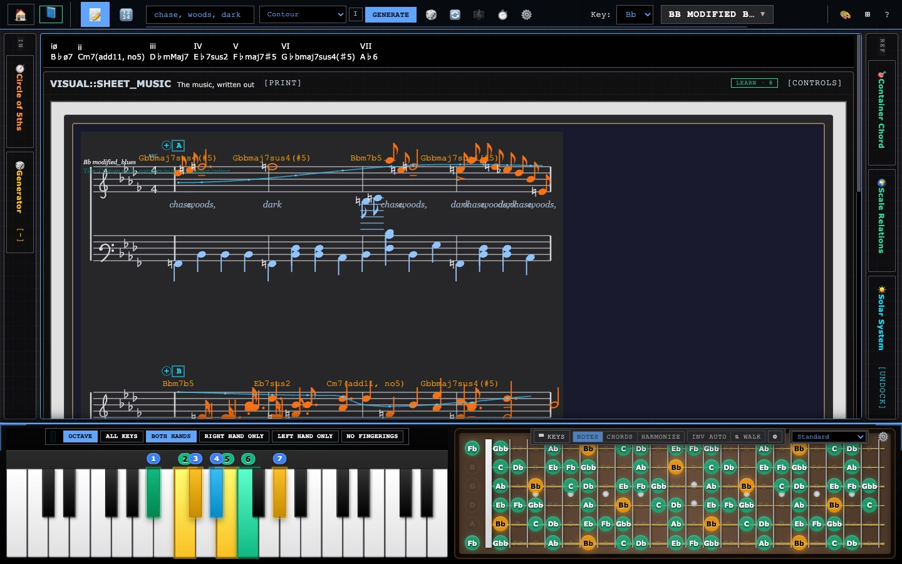
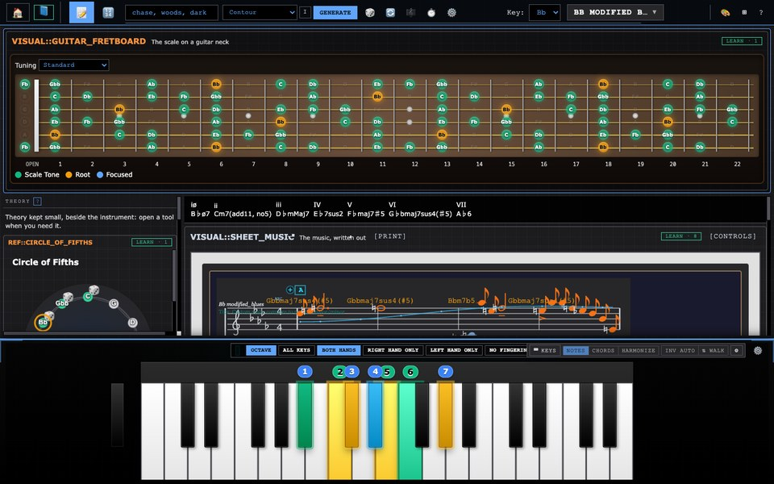
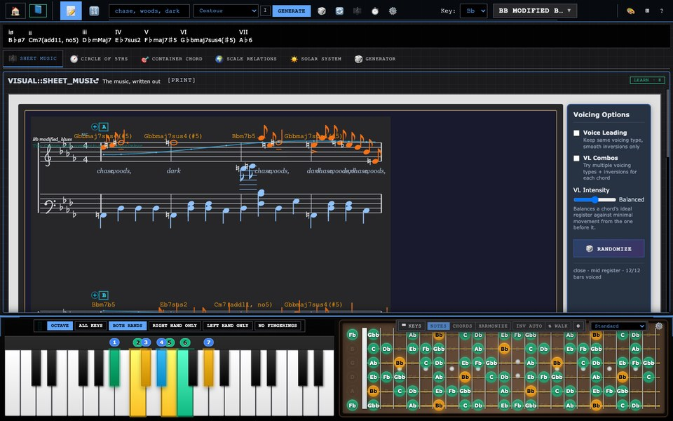

# Music Theory Studio

**Type a few words and get a piece of music that can explain itself.**

### [Open the studio →](https://parkerchace.github.io/MusicTheory/modular-music-theory.html)

Free · Runs in your browser · No install, no account · Nothing you type leaves your computer



Music Theory Studio is a workshop for how music is made. Give it a phrase, such as *chase, woods, dark*, and it chooses a key and scale from what the words mean. It then plans a form, writes harmony, melody and accompaniment, and engraves the result as a score you can hear, play along with and export as MIDI.

Then it shows its work. A borrowed chord or a note from outside the key can say where it came from and why it is there. The aim is not a random-music machine. It is a composer that can be questioned, inside a set of theory tools you can rearrange to match how you think, with a course that teaches from those same tools.

---

## Try it in one minute

1. **[Open the studio](https://parkerchace.github.io/MusicTheory/modular-music-theory.html)**, scroll past the course and the tool list, and press **Launch Full Studio**. To be taught first, pick a lesson from the course at the top of the page instead.
2. Type a few words into the box in the top bar (try *the long walk home through winter woods*) and press **Generate**.
3. Press **▶ Play** on the score. Some looks fold it behind **[CONTROLS]** in the score's header. Open **Where the music comes from**, just above the score, to see why each chord and colour was chosen.
4. Click the piano. Your computer keyboard is now an instrument: `Z S X D C…` play notes, and holding **Shift** plays the scale's chords.
5. Press **⊞** in the top bar and pick a different *look*. It is the same studio, arranged around a different idea.

---

## What's inside

### Words into music
- **Meaning, not only sound.** Words are read against hand-built fields (motion, stillness, impact, rise, fall, bright, dark, tension, tenderness, sorrow, vastness, smallness), with "not", "very" and "barely" applied to the word that follows, and for how they sound and scan. A word the fields don't know counts as neutral rather than guessed at.
- **Seven ways to read a text.** *Contour* plays the shape of a line you draw (with mouse, finger or pen). *Cipher* spells a melody from your letters. *Cast of Themes* turns each word into a recurring subject. *Spotting* treats sentences as film-cue sections, with punctuation as the edit. *Blocks* builds the whole piece from a handful of bars, reordered and stacked. *Pedal & Colour* holds one bass note under shifting harmony. *Two Lines* writes a melody on top and another on the bottom.
- **A line that says what it draws.** In Contour, *The line is* sets what your drawing stands for: the energy of the whole piece, the shape of each phrase, the melody itself, or a short motif. *Suggest a shape* offers 15 named shapes to start from or keep.
- **Real musical form.** 33 forms in 11 families: sentence and period, binary and rounded binary, rondo, sonata, fugal exposition, theme and variations, passacaglia, minuet and trio, call and response, and more. **Expand** turns a piece into a multi-movement *work*, from 8 plans (sonata cycle, song cycle, dance suite, concerto, diptych and others), with contrast between movements, a key plan that comes home, and later movements quoting earlier ones.
- **Devices you can switch on.** *Approach scales* borrows a whole collection that points at the next chord and walks into it. *Departures* step out to another key's colour and come back.

### A composer that explains itself
- **Outside notes are placed on purpose.** A chromatic note comes from somewhere: a borrowed collection, a leading tone, an approach, a planned excursion. Tests measure how many slip through without a reason.
- **Where the music comes from** opens above the score. It gives the home key, the form, each borrowed chord with its source scale and purpose (you can audition each one), every trip out of the key and back, the progression, why melody notes leave the scale, and how the texture changes.
- **Change one thing at a time.** *Adjust this take* keeps the seed and changes a single decision, so you hear only that decision.

### A course that teaches inside the studio
- **20 lessons at three levels.** *Beginner* covers notes, scales, chords, inversions, chord symbols, endings and common progressions. *Intermediate* covers voicings and drop 2, bebop major, and the 5-of and 4-of ways into any chord. *Advanced* covers approach chords, chromatic mediants and progressions into a target. Intermediate and Advanced are built from the lecture *Finding Melodies in Scales*.
- **Lessons use the real tools.** A studio lesson lays out only the tools it needs and leaves the rest in a drawer. **Show me** points at the control, **Do it for me** makes the setting, and each step ticks itself when the studio reaches that state. Other lessons have playable tables and games: chord symbols on any root, guess-the-ending, and progressions that load into the generator.
- **Five guided Learn pages** cover notes on piano, notes on guitar, scales, chords and inversions, each with a check and a next lesson. Choose the guitar and the whole course stays on it: necks in place of keyboards, its sound, its words, and in studio lessons a dock with only the guitar. The piano, scales and chords pages listen to the typing keyboard and to MIDI, so you can practise on a real instrument.
- **Tools point back to lessons.** In every look but OG, a *Learn* chip on each module lists the lessons that use it.

### A studio you can rearrange, and learn from
- **Five built-in "looks"** rearrange the same tools around a different principle. *Stage & Wings* gives the score the whole stage with every tool a click away at the edges. *Notation Desk* keeps page proportions and puts the reference tools behind a drawer. *Luthier* is for players and puts the fretboard first. *Focus* shows one tool at a time. *OG* is the original layout, never altered.
- **Build your own look.** Remix any look or start from a skeleton, give each zone a purpose, and name the idea behind it. Looks save in your browser and export as a small `.look.json` file another person can import.

<p>
  
  
</p>

### Play it
- **Your computer keyboard is an instrument**, laid out like FL Studio's: two rows of piano keys, ← → for octave and ↑ ↓ for velocity. It never takes over while you are typing in a text box.
- **Chords mode** puts the scale's chords under your fingers, with sevenths on the row above and secondary dominants on the black keys. Each chord is voiced by the same engine that voices the score: 18 voicing styles (close, drops, shells, quartal, gospel, rootless and more) plus 5 automatic voicing strategies, with voice leading between chords. **A** picks the inversion. **F** "walks" the inversions as you play.
- **Harmonize mode** treats what you play as a melody and puts a chord from the scale underneath it. It works with a MIDI keyboard too.
- **One guitar tuning everywhere.** Choose from 12 tunings (Drop D, DADGAD, open tunings and more) or type your own. Every neck has the menu, in the studio and on the Learn pages. Necks, chord shapes and lessons all follow it, and it is remembered for your next visit.
- **Nine playback voices** (piano, electric piano, strings, guitar, pads), **MIDI export** to any DAW, and a print-ready score.

### Reference
A scale library of **all 2,048 sets of notes that contain a root** (see below), each with a key signature computed from its own notes. A circle of fifths, a chord finder ("which chords contain these notes?"), a scale finder ("which scales contain this chord?"), a solar-system map of the scale, and four visual themes.

---

## The idea

Most generative music is individually correct and collectively about nothing. The studio already had the theory machinery. The hard part was **intention**: placement, commitment, repetition and restraint. The generator is tuned against pieces that show those qualities:

- **Minuet in G**: simple chords, full of character, because it moves in gestures that commit to a direction.
- **Für Elise**: chromatic notes exist for motion, and there are very few of them. The E–D♯–E rub works because it keeps coming back.
- **Bach's Prelude in C**: one figure, never varied, while the harmony walks through it.
- **Pachelbel**: a melody on top and a melody on the bottom at the same time.
- **Ellington**: a highlighted moment is built on and escalated, not repeated.

That philosophy runs through the whole app. Each look is a theory of what belongs next to what. The score can account for its chromatic notes. The musical rules are checked by tests in `tools/` that measure them across hundreds of generated pieces.

---

## Where the work stands

*As of November 5, 2026.*

### In progress: repairing the scale catalogue

The scale picker was the part of the app that most misrepresented what it knew. Names had lost their accidentals ("Mixolydian 6" was really Mixolydian ♭6), each scale had only one name, 119 scales couldn't be reached, and 562 of the 2,048 possible sets of notes were missing, including Whole Tone, Bebop Dominant and Chromatic. This repair is planned to finish by November 13.

| Phase | What it does | Status |
| --- | --- | --- |
| 0. Safety net | Records a baseline of every test and scale id, adds a catalogue test, and fixes Learn Scales' Harmonic and Melodic Minor, which pointed at the wrong scales | **Done** |
| 1. Family rules | A scale now earns its family by name, not by a guess from its intervals. Blues went from 1,044 scales to the 15 that are really blues | **Done** |
| 2. Ids and names | Generates the catalogue from a build script: a unique id for every scale, accidentals restored, every old name kept, and every other name a scale answers to kept and shown in its own family (Dorian appears as 22 Kharaharapriyā under Carnatic and Kafi thaat under Hindustani). Raga parents that sources disagree on are stored as main + alternates; names no source supports are marked unconfirmed | **Done** |
| 3. Search | Finds a scale by any of its names, ignoring case, diacritics and ♭/b spelling, and shows which name matched. "Kafi", "raga bhim" and "mixolydian b6" all work | **Done** |
| 4. Word generator | Was to limit word generation to well-known scales | **Dropped:** the generator keeps the whole catalogue |
| 5. Missing scales | Adds the 562 missing sets, for all 2,048, places them in families, and checks the app stays fast at that size | **Done:** placed; the picker and chord analysis were timed at the full size |
| 6. Finish | Updates the counts, runs every check at both window widths, and rehearses the demo path | In progress |

### Recently finished

- **Looks and the typing keyboard:** looks as validated data, the look builder, chord and harmonize modes, and the inversion walk.
- **The course:** lessons for all three levels, lesson steps tied to real controls, and playable widgets.
- **Learn page consistency:** one header, one check and one way to the next lesson across all five pages, with Learn Chords and Learn Notes on guitar rebuilt.
- **Guitar tuning:** one setting shared by every neck and Learn page, with the menu on every neck in every look. The instrument chosen for the course now holds through every lesson.
- **The grading key is gone:** the key, its Functional / Emotional / Color menu and its unbuilt Help items are removed. The piano keeps its degree colours and the chord finder keeps plain fit labels. Looks saved with the key still load, without it.
- **Contour:** drawn by hand with named shape suggestions, with the old word lexicons removed in favour of a smaller word reader.

### Known rough edges

- **Undo in text boxes:** Ctrl/Cmd+Z in a text box hits an error and does nothing.
- **Stopping:** a score that is playing can keep going after you leave the studio.
- **Engraving:** the score can print a raw scale id and a "Tips" line inside the staff, and lyrics can collide.
- **Number generator:** **Play Sequence** does nothing yet.
- **Long sessions:** the app's interaction log grows without limit.

### Planned next

- **Notation:** tuplets, slurs, and key changes shown in the score when a work modulates between movements.
- **Phones:** a layout and sound that work there, including a test on a real iOS device.
- **Scale direction:** different ascents and descents shown on the keys, for ragas and maqams with a source for the path.
- **Guides:** a feature guide, a guide to what the generator is doing and why, and a generated reference for the form and work catalogues.

### Where it could go

- **Classrooms.** A look is a lesson plan in miniature. A teacher can build one that puts exactly the tools a unit needs in the order it teaches them, then share it as a file.
- **Songwriting and scoring.** Spotting reads a scene description as cue timings. Two Lines and the approach devices produce material worth taking into a DAW through MIDI export.
- **Practice.** Chords mode and Harmonize make any keyboard, MIDI or QWERTY, into a voice-leading and harmony trainer.
- **Research and teaching about text and music.** Seven explicit, inspectable readings of text into music, each one documented in the app with what it reads and what it controls.

---

## Running it yourself

It is plain HTML, CSS and JavaScript with no build step and no dependencies to install.

```sh
git clone https://github.com/parkerchace/MusicTheory.git
cd MusicTheory
python3 -m http.server 8000
# open http://localhost:8000/modular-music-theory.html
```

Opening `modular-music-theory.html` straight from disk also works. A local server is better for Web MIDI.

**Browsers:** current Chrome, Edge or Firefox, all of which support MIDI keyboards. Safari has no Web MIDI, so it runs the studio without MIDI input. It is designed for a desktop or laptop screen; a phone layout is planned.

### Tests

**Engine tests** run in JavaScriptCore, which ships with macOS, so no Node is required. There are 49 files in `tools/`, and the slowest takes about a minute:

```sh
JSC=/System/Library/Frameworks/JavaScriptCore.framework/Versions/Current/Helpers/jsc
$JSC tools/<name>-test.js                 # one test
for t in tools/*.js; do $JSC "$t" > /dev/null 2>&1 || echo "FAILED $t"; done
```

On November 5, 2026, 45 of the 49 passed on the rebuilt catalogue. The other four are long-standing: `accidentals-test` (78 of 27,152 melody notes have no explanation), `melodic-paths-test`, `metric-hierarchy-test` and `modal-excursion-test`.

**Browser checks** drive the real app in muted headless Chrome. There are 85, and a full run takes 40 minutes or more per window width, so split it with `--shard`:

```sh
python3 tools/screens/look-screens.py checks                   # all checks at 1440x900
python3 tools/screens/look-screens.py checks --size 760x900    # a narrow window
python3 tools/screens/look-screens.py checks --only course     # checks with "course" in the name
python3 tools/screens/look-screens.py checks --shard 0/3       # the first of three parts
python3 tools/screens/look-screens.py shots                    # a screenshot of every look
python3 tools/screens/look-screens.py course                   # the landing page and every studio lesson
```

### Where things live

| Area | Files |
| --- | --- |
| Page and app wiring | `modular-music-theory.html`, `modular-app.js`, `module-selector.js` (landing page and page switching), `tutorial-system.js`, `theme-switcher.js` |
| Words → context | `context-engine.js`, `word-character-engine.js`, `semantic-contour-engine.js`, `scale-intelligence-engine.js`, `scoring-methods.js` (the seven readings and the devices) |
| Composition | `arc-ui-init.js` (the pipeline), `form-planner.js`, `functional-harmony.js`, `harmony-complexity.js`, `progression-library.js`, `numeric-progression.js`, `approach-engine.js`, `scale-colour.js`, `melodic-line-engine.js`, `piano-texture-engine.js` |
| Contour and adjusting a take | `composition-timeline-ui.js`, `contour-meaning.js`, `composition-controls.js` |
| Score, voicing, playback, MIDI | `sheet-music-generator.js`, `voice-leading-engine.js`, `music-provenance-panel.js`, `simple-audio-engine.js`, `enhanced-audio-engine.js`, `piano-sample-engine.js` |
| Theory data and scale picker | `music-theory-engine.js`, `chord-attribute-engine.js`, `scales-data-embedded.js`, `scales-loader-embedded.js`, `scale-taxonomy.js`, `scale-library.js`, `scale-helper.js`, `tools/scales/` (the catalogue build) |
| Theory tools | `number-generator.js`, `container-chord-tool.js`, `scale-relationship-explorer.js`, `scale-circle-explorer.js`, `solar-system-visualizer.v2.js` |
| Looks | `look-schema.js` (what a look is, and its validator), `studio-looks.js`, `look-builder.js`, `module-fit.js` |
| Instruments and input | `piano-visualizer.js`, `guitar-fretboard-visualizer.js`, `guitar-tuning.js` (the one tuning every neck reads), `instrument-dock.js`, `qwerty-keys.js`, `qwerty-chords.js`, `midi-input-manager.js` |
| Course | `course.js` (the lessons), `course-runner.js` (a lesson inside the studio), `course-theory.js` (spelling and chord naming), `course-widgets.js` (playable tables and games), `course.css` |
| Learn pages | `learn-common.js` (what they share), `learn-piano-notes.js`, `learn-guitar-notes.js`, `learn-scales.js`, `learn-chords.js`, `learn-inversions.js` |

---

## Credits

Created by **Parker Chace**.
