# Music Theory Studio

**A music theory course and a set of interactive tools you can see, hear and play.**

### [Open the studio →](https://parkerchace.github.io/MusicTheory/modular-music-theory.html)

Free · Runs in your browser · No install, no account · Nothing you type leaves your computer


Music Theory Studio teaches theory by putting it under your fingers. A 20-lesson course runs from the names of the notes to chromatic mediants, on piano or guitar. Its lessons open the same tools you keep using afterwards: a circle of fifths, a solar-system map of the scale, chord and scale finders, a catalogue of every scale, a score, and a keyboard and neck that light up with whatever you are looking at.

---

## Start here

1. **[Open the studio](https://parkerchace.github.io/MusicTheory/modular-music-theory.html).** The course is at the top of the page.
2. Choose piano or guitar under *Your instrument for the course*, then open **Notes on your instrument**, or pick a later level if you already know the basics.
3. To go straight to the tools, scroll past the course and press **Launch Full Studio**.
4. Click the piano. Your computer keyboard is now an instrument: `Z S X D C…` play notes, and holding **Shift** plays the scale's chords.
5. Press **⊞** in the top bar and pick a different *look*. It is the same studio, arranged around a different idea.

New here? The first launch offers a short tour, and the **?** menu has it again as Easy Mode, along with Demo Mode, which explains any tool you hover over.

---

## The course

**20 lessons at three levels, in order.** Intermediate and Advanced are built from the lecture *Finding Melodies in Scales*.

| Level | Unit | Lessons |
| --- | --- | --- |
| **Beginner** | Fundamentals | Notes on your instrument · Scales (nine short lessons) · Chords from intervals · Inversions · Reading chord symbols · Endings: how a phrase comes home · Common chord progressions |
| **Intermediate** | Voicings: room for a melody | Start with the close-voiced chord · Drop 2 · Inverted drop 2s · Drop 2 & 4 and drop 3 |
| | Interesting scales: bebop major | Bebop major: eight notes, two chords · Harmonize a melody: 6 or °7? |
| | Two ways into any chord | The 5-of and the 4-of |
| **Advanced** | Approach chords | A °7 a half step below · Tonicize the target, borrow from a scale on it · Scales carry moods |
| | Approach by interval | A fifth away: Mixolydian, and ♭6 for minor · A third away: chromatic mediants |
| | Progressions into a target | Tonicize with a whole progression |

<p>
  
  
</p>

### Lessons happen inside the real tools

- **Only what the lesson needs.** A studio lesson lays out the tools it uses and leaves the rest in a *More tools* drawer.
- **Show me.** A button points at the control the lesson means, and a second button beside it makes the setting for you.
- **Steps that notice.** A step that sets something ticks itself when the studio reaches that state.
- **Things to play.** Every lesson has examples to hear, and five add a playable part: chord symbols on any root, a guess-the-ending game, progressions that load into the Generator, and tables of the ways into a chord.

<p>
  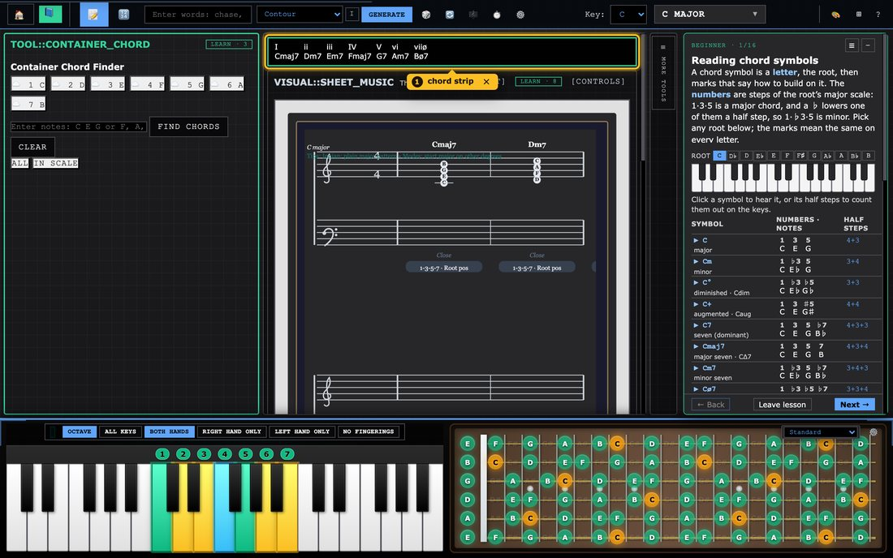
  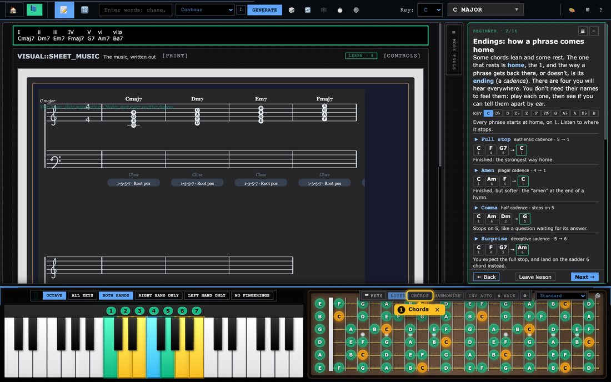
</p>

### Five guided Learn pages

The Beginner lessons on notes, scales, chords and inversions open pages built for a first-time student. Each has its own practice or check and a way on to the next lesson, and progress is saved in your browser.

<p>
  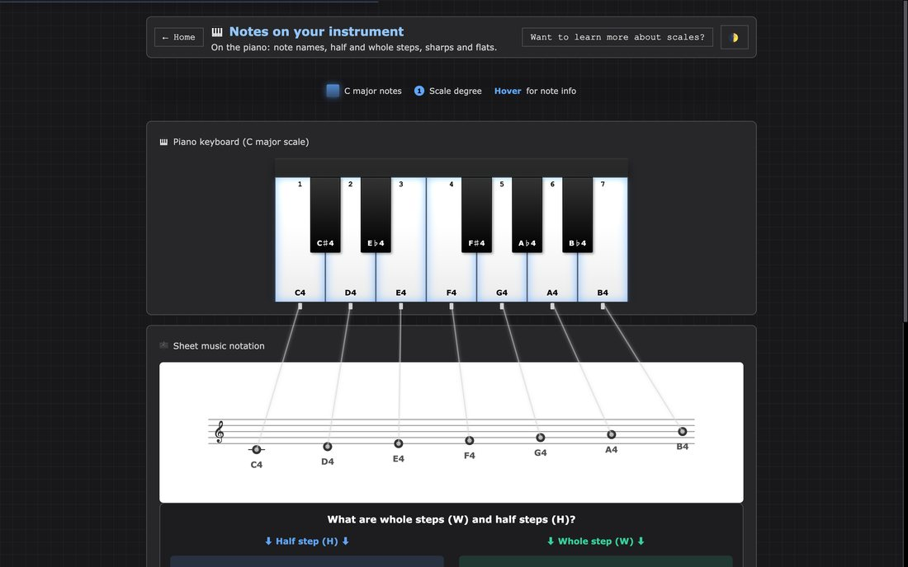
  
</p>
<p>
  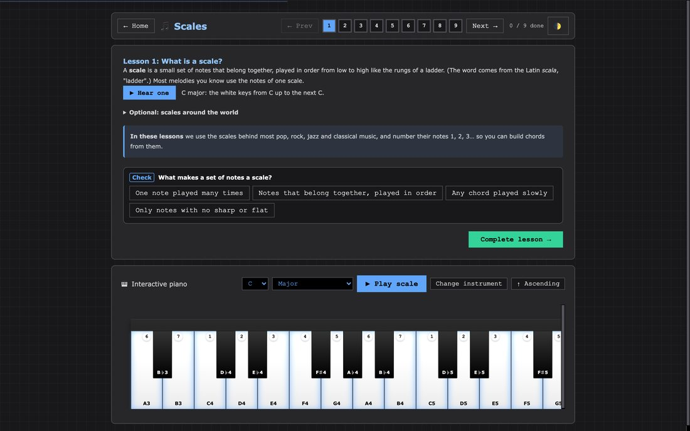
  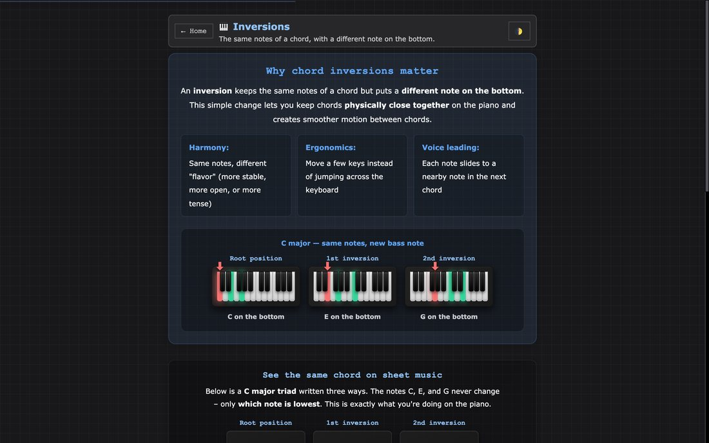
</p>
<p>
  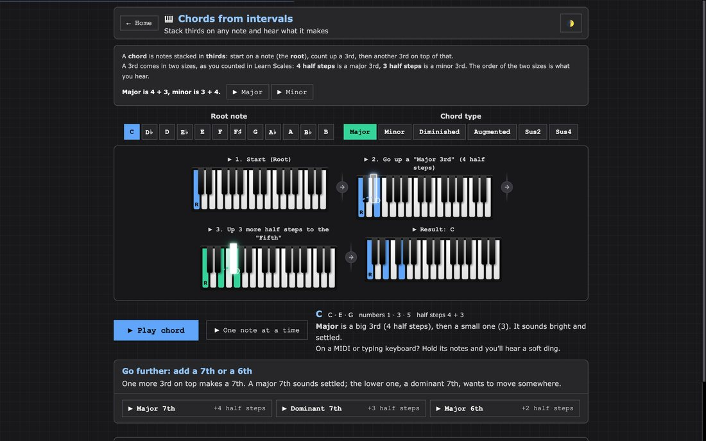
  
</p>

### Your instrument, all the way through

Choose the guitar and the Learn pages show necks in place of keyboards, with its sound and its words, and studio lessons show a dock with only the guitar. The piano, guitar, scales and chords pages listen to the typing keyboard and to MIDI, so you can practise on a real instrument.

**Tools point back to lessons.** A *Learn* chip on a module header lists the lessons that use it, and the Studio tools cards on the landing page do the same. The OG look and folded rails don't show the chip.

---

## The tools

Every tool follows the same key and scale, so a change in one shows up in the others. The **Chord Strip** above the score keeps one chord for each degree of the scale in view.

### Circle of 5ths and Solar System

The **Circle of 5ths** shows keys as wedges, with a relative-minor ring, and clicking one changes the studio's key. It switches to 4ths or chromatic order and numbers the scale's notes (Notes / 1 2 3 / Both).

The **Solar System** shows the scale as orbits around its tonic, with every note a numbered planet on its own ring. Click a planet to zoom in on its moons: the chords that lead to it or hold it, each numbered from the planet and named for its role, such as tritone sub, five-of and chromatic mediant. Click a moon to add it to the score.

<p>
  
  
</p>


### Container Chord

*Which chords contain these notes?* Type or pick the notes, narrow the list to the scale if you like, group the answers by fit, root or family, and add a chord to the score.

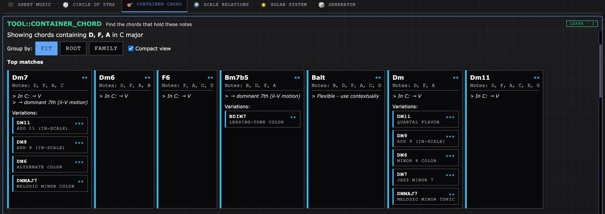

### Scale Relations

*Which scales contain this chord?* Filter by tonic, then preview a scale on a piano with its chords, or apply it to the studio.

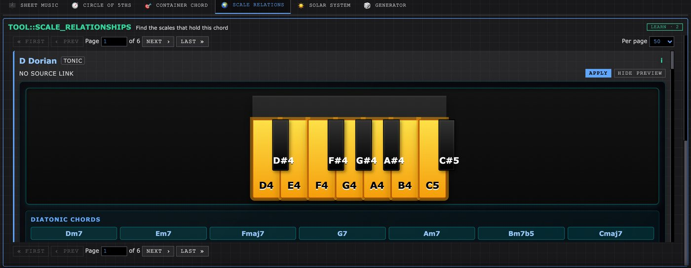

### Sheet Music

The score, with chord names and how each one is voiced. Its toolbar sets staff, bars, tempo, voicing, feel and sound, and **+** marks add a section to the form.

- **18 voicing styles** (close, drops, shells, quartal, gospel, rootless and more) plus 5 automatic strategies, with voice leading between chords. Set them for the whole piece or bar by bar.
- **Nine playback voices:** piano (plain, with reverb, pad or strings), strings, guitar, electric piano, and R&B synth and pad.
- **Feel:** four swing settings, three levels of expressive timing, and notes pushed or laid back against the grid.
- **MIDI export** to any DAW, matching what is on the page.

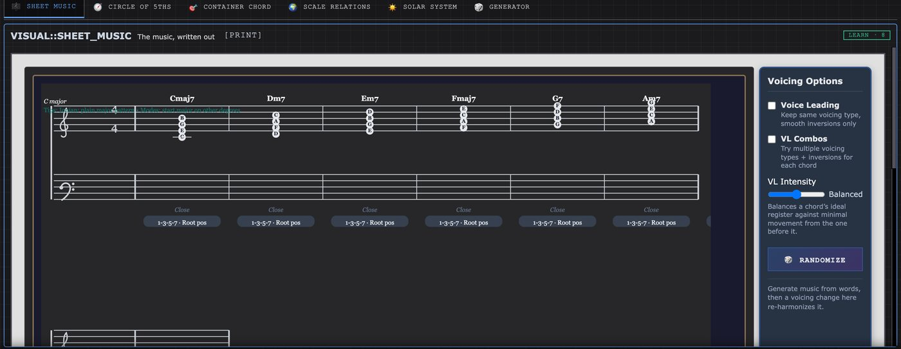

### Generator

Type a progression as numbers, numerals or chord names, or generate one with a logic of your choice, then rotate it, run it backwards or swap in a common progression. It writes degrees as numbers, and the **123** button switches them to roman numerals.

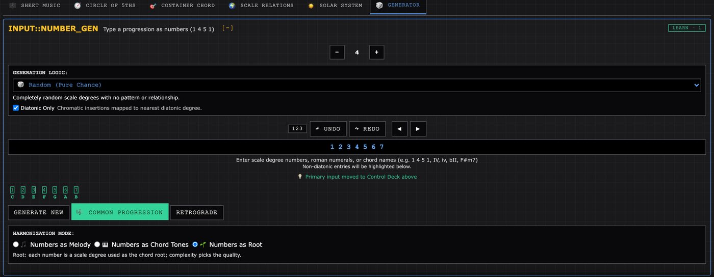

### Piano and Fretboard

The instrument dock runs along the bottom of the studio and shows the scale and the chord being played. The piano has scale degrees in colour and standard fingerings for either hand or both, which you can turn off.

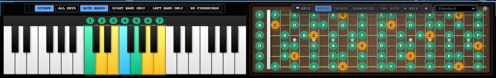

- **Your computer keyboard is an instrument**, laid out like FL Studio's: two rows of piano keys, ← → for octave and ↑ ↓ for velocity. It never takes over while you are typing in a text box.
- **Chords mode** puts the scale's chords under your fingers, with sevenths on the row above and secondary dominants on the black keys. Each chord goes through the same voicing engine as the score. **A** picks the inversion. **F** "walks" the inversions as you play.
- **Harmonize mode** treats what you play as a melody and puts a chord from the scale underneath it. It works with a MIDI keyboard too.
- **One guitar tuning everywhere.** Choose from 12 tunings (Drop D, DADGAD, open tunings and more) or type your own. Necks, chord shapes and lessons all follow it, and it is remembered for your next visit.

---

## The scale catalogue

**All 2,048 sets of notes that contain a root**, with over 3,800 further names kept alongside the display names and shown in their own traditions. Dorian also appears as 22 Kharaharapriyā under Carnatic and Kafi thaat under Hindustani. Names that no source confirms are marked as such, and scales from other traditions are marked as approximations in twelve notes.

- **Four ways in:** a Family Tree of 24 families, each organised by its own tradition's system (modes, jazz parents, thaats, melakarta, maqam and more), a Special View, and From Major or From Minor by how many notes differ.
- **Search by any name,** ignoring case, diacritics and ♭/b spelling, and see which name matched. "Kafi", "raga bhim" and "mixolydian b6" all work.
- **Spelled from its own notes.** Seven-note scales get a key signature counted from the scale itself. Other sizes are written without a signature.

<p>
  
  
</p>

---

## A studio you can rearrange

- **Five built-in looks** rearrange the same tools around a different principle. *OG* is the original layout, with everything on screen, and is where the studio opens. *Stage & Wings* gives the score the whole stage, with every tool a click away at the edges. *Notation Desk* keeps page proportions and puts the reference tools behind a drawer. *Luthier* is for players and puts the fretboard first. *Focus* shows one tool at a time.
- **Build your own look.** Remix any look or start from a skeleton, give each zone a purpose, and name the idea behind it. Looks save in your browser and export as a small `.look.json` file another person can import.
- **Four visual themes:** Clean DAW, Channel Strip, Matrix FX and Steam 2000. The 🎨 button steps through them.

<p>
  
  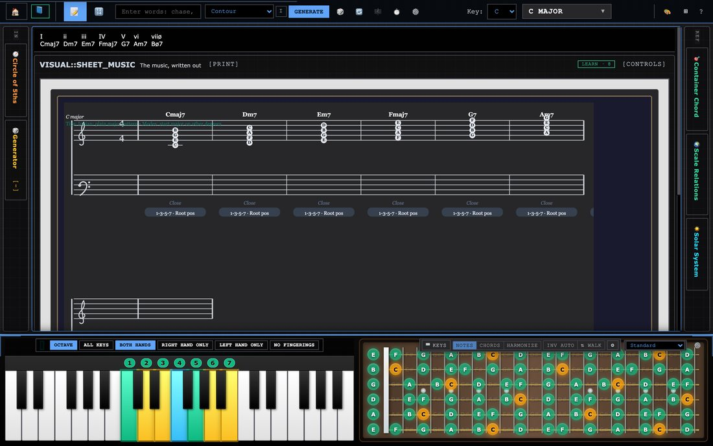
</p>
<p>
  
  
</p>
<p>
  
  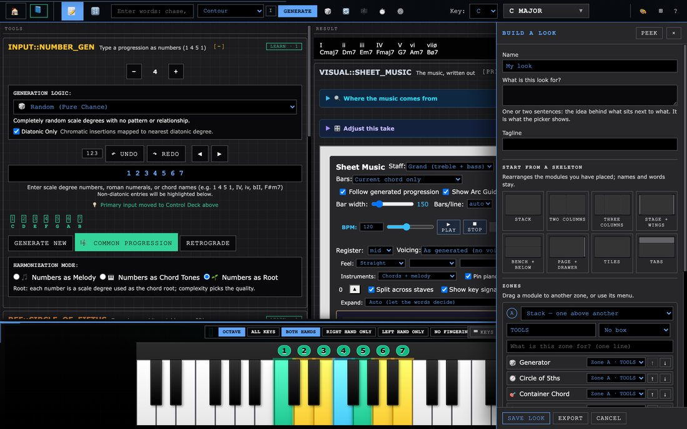
</p>

---

## Writing music from words

The studio can also write a piece for you to hear and take apart. It is a smaller part of the app. Type a few words in the top bar and press **Generate**, then **▶ Play** in the score's toolbar. Every press is a new take.

- **Reading the words.** Words are read against 12 hand-built fields of meaning and for how they sound and scan. The meaning leans the choice of key and shapes the piece; the rest comes from the take's seed.
- **Seven readings of a text.** *Contour* plays the shape of a line you draw, with 15 named shapes to start from. *Cipher* spells a melody from your letters. *Cast of Themes* turns each word into a recurring subject. *Spotting* treats sentences as film-cue sections. *Blocks* builds the piece from a handful of bars. *Pedal & Colour* holds one bass note under shifting harmony. *Two Lines* writes a melody on top and another on the bottom.
- **Form.** 33 forms in 11 families, from sentence and period to sonata and passacaglia. **Expand**, on the score's toolbar, turns a piece into a multi-movement work from 8 plans.
- **Devices.** *Approach scales* borrow a whole collection that points at the next chord and walk into it. *Departures* step out to another key's colour.
- **It explains itself.** *Where the music comes from* gives the home key, the form, each borrowed chord with its source scale and purpose, and why melody notes leave the scale. *Adjust this take* keeps the seed and changes one decision, so you hear only that decision.

<p>
  
  
</p>

The generator is tuned against pieces that commit to an idea: Minuet in G for gestures with a direction, Für Elise for few chromatic notes that keep coming back, Bach's Prelude in C for one figure while the harmony walks through it, Pachelbel for a melody on top and on the bottom at once, and Ellington for a moment that is built on and escalated. Tests in `tools/` measure these musical rules across many seeded pieces.

---

## Where the work stands

*As of November 6, 2026.*

### Finishing: the scale catalogue

The scale picker was the part of the app that most misrepresented what it knew. Names had lost their accidentals, each scale had only one name, 119 scales couldn't be reached, and 562 of the 2,048 sets of notes were missing, including Whole Tone and Chromatic. Family rules, unique ids, restored names, search by any name and the full 2,048 are all in. What remains, planned by November 13, is a final run of every check at both window widths and a rehearsal of the demo path.

### Recently finished

- **Number generator:** degrees are written as numbers first, with roman numerals a click away. The Play Sequence and Harmonize buttons are gone, and the left column in OG holds its width.
- **Solar System and Circle of Fifths:** both redrawn to fit any look, with numbers on the notes and one thin control bar. See [The tools](#the-tools).
- **Five looks instead of thirteen:** the ones that gave every tool room to work.
- **The course:** lessons for all three levels, steps tied to real controls, playable widgets, and one shared frame for all five Learn pages.
- **Guitar tuning:** one setting shared by every neck and Learn page. The instrument chosen for the course holds through its lessons.
- **The grading key is gone:** the piano keeps its degree colours and the chord finder keeps plain fit labels. Looks saved with the key still load, without it.
- **Contour:** drawn by hand with named shape suggestions, with the old word lexicons replaced by a smaller word reader.

### Known rough edges

- **Undo in text boxes:** Ctrl/Cmd+Z in a text box hits an error and does nothing.
- **Printing:** the score's **[PRINT]** button isn't connected to anything yet.
- **Stopping:** a score that is playing can keep going after you leave the studio.
- **Engraving:** the score prints a raw scale id above the staff and a "Tips" line across it, and lyrics can collide.
- **Guitar in the course:** the chord-symbols table in *Reading chord symbols* always draws a keyboard, even when you chose the guitar.
- **Spelling in Container Chord:** flats can be listed as sharps. C7 shows as C, E, G, A♯ even in C major.
- **Harmonization mode:** the Generator's three choices reach the score, but none of them changes a generated piece yet. The chord picking behind them was removed with the old progression builder.
- **Leftovers:** a greyed-out *Send → Bitwig* button on the score's toolbar, a Generator hint pointing at a "Control Deck" that no longer exists, and some landing-page tool descriptions older than the tools they describe.
- **Long sessions:** the app's interaction log grows without limit.

### Planned next

- **Notation:** tuplets, slurs, and key changes shown in the score when a work modulates between movements.
- **Phones:** a layout and sound that work there, including a test on a real iOS device.
- **Scale direction:** different ascents and descents shown on the keys, for ragas and maqams with a source for the path.
- **Guides:** a feature guide, a guide to what the generator is doing and why, and a generated reference for the form and work catalogues.

### Where it could go

- **Classrooms.** A look is a lesson plan in miniature. A teacher can build one that puts exactly the tools a unit needs in the order it teaches them, then share it as a file.
- **Practice.** Chords mode and Harmonize make any keyboard, MIDI or QWERTY, into a voice-leading and harmony trainer.
- **Songwriting and scoring.** Spotting reads a scene description as cue timings. Two Lines and the approach devices produce material worth taking into a DAW through MIDI export.
- **Research and teaching about text and music.** Seven explicit, inspectable readings of text into music, each one documented in the app with what it reads and what it controls.

---

## Running it yourself

It is plain HTML, CSS and JavaScript with no build step and nothing to install.

```sh
git clone https://github.com/parkerchace/MusicTheory.git
cd MusicTheory
python3 -m http.server 8000
# open http://localhost:8000/modular-music-theory.html
```

Opening `modular-music-theory.html` straight from disk also works. A local server is better for Web MIDI.

**Browsers:** current Chrome, Edge or Firefox, all of which support MIDI keyboards. Safari has no Web MIDI, so it runs the studio without MIDI input. It is designed for a desktop or laptop screen; a phone layout is planned.

### Tests

**Engine tests** run in JavaScriptCore, which ships with macOS, so no Node is required. There are 51 files in `tools/`, and the slowest takes about a minute:

```sh
JSC=/System/Library/Frameworks/JavaScriptCore.framework/Versions/Current/Helpers/jsc
$JSC tools/<name>-test.js                 # one test
for t in tools/*.js; do $JSC "$t" > /dev/null 2>&1 || echo "FAILED $t"; done
```

On November 6, 2026, 44 of the 51 passed. Of the other seven, four are long-standing musical targets not yet met: `accidentals-test` (78 melody notes have no explanation), `melodic-paths-test`, `metric-hierarchy-test` and `modal-excursion-test`. Three are out of date and need updating: `look-schema-test` and `look-wire-test` still ask for looks that were removed, and `scale-switch-reset-test` still expects the Generator to write roman numerals by default.

**Browser checks** drive the real app in muted headless Chrome. There are 87, and a full run takes 40 minutes or more per window width, so split it with `--shard`:

```sh
python3 tools/screens/look-screens.py checks                   # all checks at 1440x900
python3 tools/screens/look-screens.py checks --size 760x900    # a narrow window
python3 tools/screens/look-screens.py checks --only course     # checks with "course" in the name
python3 tools/screens/look-screens.py checks --shard 0/3       # the first of three parts
python3 tools/screens/look-screens.py shots                    # a screenshot of every look
python3 tools/screens/look-screens.py course                   # the landing page and every studio lesson
```

On November 6, 2026, all 87 passed at 1440x900 with no page errors.

### Where things live

| Area | Files |
| --- | --- |
| Page and app wiring | `modular-music-theory.html`, `modular-app.js`, `module-selector.js` (landing page and page switching), `tutorial-system.js`, `theme-switcher.js` |
| Course | `course.js` (the lessons), `course-runner.js` (a lesson inside the studio), `course-theory.js` (spelling and chord naming), `course-widgets.js` (playable tables and games), `course.css` |
| Learn pages | `learn-common.js` (what they share), `learn-piano-notes.js`, `learn-guitar-notes.js`, `learn-scales.js`, `learn-chords.js`, `learn-inversions.js` |
| Theory tools | `number-generator.js`, `container-chord-tool.js`, `scale-relationship-explorer.js`, `scale-circle-explorer.js`, `solar-system-visualizer.v2.js`, `viz-controls.css` (the bar the circle and the solar system share) |
| Instruments and input | `piano-visualizer.js`, `guitar-fretboard-visualizer.js`, `guitar-tuning.js` (the one tuning every neck reads), `instrument-dock.js`, `qwerty-keys.js`, `qwerty-chords.js`, `midi-input-manager.js` |
| Theory data and scale picker | `music-theory-engine.js`, `chord-attribute-engine.js`, `scales-data-embedded.js`, `scales-loader-embedded.js`, `scale-taxonomy.js`, `scale-library.js`, `scale-helper.js`, [`tools/scales/`](tools/scales/README.md) (the catalogue build) |
| Score, voicing, playback, MIDI | `sheet-music-generator.js`, `voice-leading-engine.js`, `music-provenance-panel.js`, `logic-path-3d.js`, `simple-audio-engine.js`, `enhanced-audio-engine.js`, `piano-sample-engine.js` |
| Looks | `look-schema.js` (what a look is, and its validator), `studio-looks.js`, `look-builder.js`, `module-fit.js` |
| Words → context | `context-engine.js`, `word-character-engine.js`, `semantic-contour-engine.js`, `scale-intelligence-engine.js`, `scoring-methods.js` (the seven readings and the devices) |
| Composition | `arc-ui-init.js` (the pipeline), `form-planner.js`, `functional-harmony.js`, `harmony-complexity.js`, `progression-library.js`, `numeric-progression.js`, `approach-engine.js`, `scale-colour.js`, `melodic-line-engine.js`, `piano-texture-engine.js` |
| Contour and adjusting a take | `composition-timeline-ui.js`, `contour-meaning.js`, `composition-controls.js` |

---

## Credits

Created by **Parker Chace**.
