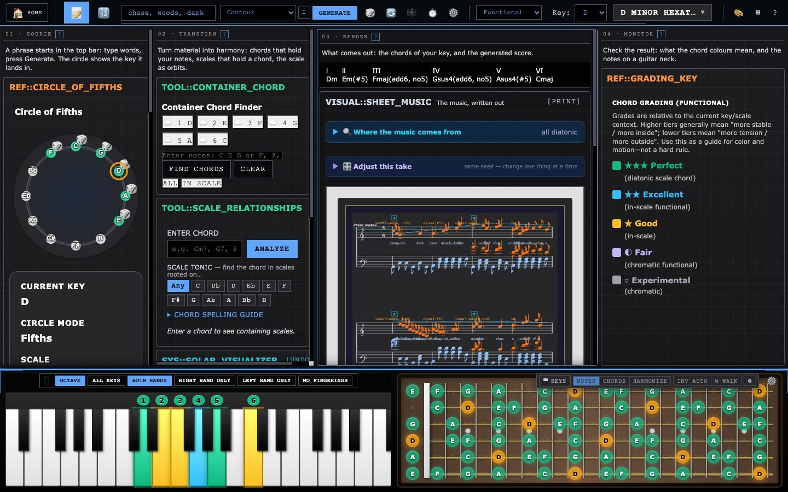
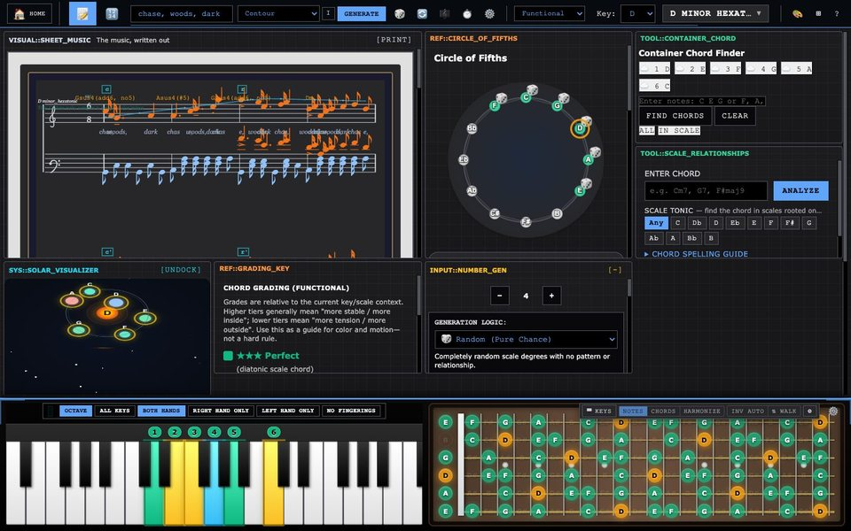

# Music Theory Studio

**Type a few words and get a piece of music that can explain itself.**

### [Open the studio →](https://parkerchace.github.io/MusicTheory/modular-music-theory.html)

Free · Runs in your browser · No install, no account · Nothing you type leaves your computer



Music Theory Studio is a workshop for how music is made. Give it a phrase, such as *chase, woods, dark*, and it chooses a key and scale from what the words mean. It then plans a form, writes harmony, melody and accompaniment, and engraves the result as a score you can hear, play along with and export as MIDI.

Then it shows its work. A borrowed chord or a note from outside the key can say where it came from and why it is there. The aim is not a random-music machine. It is a composer that can be questioned, inside a set of theory tools you can rearrange to match how you think.

---

## Try it in one minute

1. **[Open the studio](https://parkerchace.github.io/MusicTheory/modular-music-theory.html)** and press **Launch Full Studio**.
2. Type a few words into the box in the top bar (try *the long walk home through winter woods*) and press **Generate**.
3. Press play on the score. Open **Where the music comes from** to see why each chord and colour was chosen.
4. Click the piano. Your computer keyboard is now an instrument: `Z S X D C…` play notes, and holding **Shift** plays the scale's chords.
5. Press **⊞** in the top bar and pick a different *look*. It is the same studio, arranged around a different idea.

---

## What's inside

### Words into music
- **Meaning, not only sound.** Words are read against hand-built fields (motion, stillness, impact, rise, fall, bright, dark, tension, tenderness, sorrow, vastness, smallness), with "not", "very" and "barely" applied to the word that follows, and for how they sound and scan. A word the fields don't know counts as neutral rather than guessed at.
- **Seven ways to read a text.** *Contour* plays the shape of a line you draw (with mouse, finger or pen) across the piece; *Suggest a shape* offers named phrase shapes to start from or keep. *Cipher* spells a melody from your letters. *Cast of Themes* turns each word into a recurring subject. *Spotting* treats sentences as film-cue sections, with punctuation as the edit. *Blocks* builds the whole piece from a handful of bars, reordered and stacked. *Pedal & Colour* holds one bass note under shifting harmony. *Two Lines* writes a melody on top and another on the bottom.
- **Real musical form.** 33 forms in 11 families: sentence and period, binary and rounded binary, rondo, sonata, fugal exposition, theme and variations, passacaglia, minuet and trio, call and response, and more. **Expand** turns a piece into a multi-movement *work* (sonata cycle, song cycle, dance suite, concerto, diptych and others), with contrast between movements, a key plan that comes home, and later movements quoting earlier ones.
- **Devices you can switch on.** *Approach scales* borrows a whole collection that points at the next chord and walks into it. *Departures* step out to another key's colour and come back.

### A composer that explains itself
- **Outside notes are placed on purpose.** A chromatic note comes from somewhere: a borrowed collection, a leading tone, an approach, a planned excursion. A test measures how many slip through without a reason.
- **Where the music comes from** lists, for each bar, the collection a chord was taken from, the device that produced it, and the sense each word was read in.
- **Chord colours** grade every chord against the key, from diatonic and stable to chromatic and experimental, under three grading systems (functional, emotional and colour).

### A studio you can rearrange, and learn from
- **Thirteen built-in "looks"** rearrange the same tools around a different principle. *Signal Chain* reads like a patch cable from source to result. *Curriculum* is a numbered lesson. *Luthier* is for players and puts the fretboard first. *Lab Bench* puts analysis on top with the score as evidence. *Command Deck* shows everything at once. *OG* is the original layout, never altered.
- **Build your own look.** Remix any look or start from a skeleton, give each zone a purpose, and name the idea behind it. Looks save in your browser and export as a small `.look.json` file another person can import.

<p>
  
  
</p>

### Play it
- **Your computer keyboard is an instrument**, laid out like FL Studio's: two rows of piano keys, ← → for octave and ↑ ↓ for velocity. It never takes over while you are typing in a text box.
- **Chords mode** puts the scale's chords under your fingers, with sevenths on the row above and secondary dominants on the black keys. Each chord is voiced by the same engine that voices the score: 18 voicing styles (close, drops, shells, quartal, gospel, rootless and more) plus 5 automatic voicing strategies, with voice leading between chords. **A** picks the inversion. **F** "walks" the inversions as you play.
- **Harmonize mode** treats what you play as a melody and puts a chord from the scale underneath it. It works with a MIDI keyboard too.
- **Nine playback voices** (piano, electric piano, strings, guitar, pads), **MIDI export** to any DAW, and a print-ready score.

### Learn
Guided pages for **note names** on piano and guitar, **scales**, **chords** and **inversions**. The piano, scales and chords pages listen to the typing keyboard and to MIDI, so you can practise on a real instrument.

### Reference
A library of **1,367 scales**, each with a key signature computed from its own notes. A circle of fifths, a chord finder ("which chords contain these notes?"), a scale finder ("which scales contain this chord?"), a solar-system map of the scale, and four visual themes.

---

## The idea

Most generative music is individually correct and collectively about nothing. The studio already had the theory machinery. The hard part was **intention**: placement, commitment, repetition and restraint. The generator is tuned against pieces that show those qualities:

- **Minuet in G**: simple chords, full of character, because it moves in gestures that commit to a direction.
- **Für Elise**: chromatic notes exist for motion, and there are very few of them. The E–D♯–E rub works because it keeps coming back.
- **Bach's Prelude in C**: one figure, never varied, while the harmony walks through it.
- **Pachelbel**: a melody on top and a melody on the bottom at the same time.
- **Ellington**: a highlighted moment is built on and escalated, not repeated.

That philosophy runs through the whole app. Each look is a theory of what belongs next to what. The score can account for its chromatic notes. The musical rules are checked by tests in `tools/` that measure them across hundreds of generated pieces.

---

## Where it could go

- **Classrooms.** A look is a lesson plan in miniature. A teacher can build one that puts exactly the tools a unit needs in the order it teaches them, then share it as a file.
- **Songwriting and scoring.** Spotting reads a scene description as cue timings. Two Lines and the approach devices produce material worth taking into a DAW through MIDI export.
- **Practice.** Chords mode and Harmonize make any keyboard, MIDI or QWERTY, into a voice-leading and harmony trainer.
- **Research and teaching about text and music.** Seven explicit, inspectable readings of text into music, each one documented in the app with what it reads and what it controls.

**Next on the roadmap:** a layout and sound that work on phones, tuplets in the notation, and key changes shown in the score when a work modulates between movements.

---

## Running it yourself

It is plain HTML, CSS and JavaScript with no build step and no dependencies to install.

```sh
git clone https://github.com/parkerchace/MusicTheory.git
cd MusicTheory
python3 -m http.server 8000
# open http://localhost:8000/modular-music-theory.html
```

Opening `modular-music-theory.html` straight from disk also works. A local server is better for Web MIDI.

**Browsers:** current Chrome, Edge or Firefox, all of which support MIDI keyboards. Safari has no Web MIDI, so it runs the studio without MIDI input. It is designed for a desktop or laptop screen; a phone layout is on the roadmap.

**Tests** run in JavaScriptCore, which ships with macOS, so no Node is required:

```sh
/System/Library/Frameworks/JavaScriptCore.framework/Versions/Current/Helpers/jsc tools/<name>-test.js
```

Browser checks drive the real app in muted headless Chrome: `python3 tools/screens/look-screens.py checks` (add `--size 760x900` for a narrow screen), and `shots` for screenshots of every look.

### Where things live

| Area | Files |
| --- | --- |
| Page and app wiring | `modular-music-theory.html`, `modular-app.js`, `module-selector.js` (landing page) |
| Words → context | `context-engine.js`, `word-character-engine.js`, `scoring-methods.js` (the seven readings) |
| Composition | `form-planner.js`, `functional-harmony.js`, `approach-engine.js`, `melodic-line-engine.js`, `piano-texture-engine.js`, `arc-ui-init.js` |
| Score, voicing, playback, MIDI | `sheet-music-generator.js`, `voice-leading-engine.js`, `music-provenance-panel.js` |
| Theory data | `music-theory-engine.js`, `scales-data-embedded.js`, `scale-library.js`, `scale-taxonomy.js` |
| Looks | `look-schema.js` (what a look is, and its validator), `studio-looks.js`, `look-builder.js`, `module-fit.js` |
| Instruments and input | `piano-visualizer.js`, `guitar-fretboard-visualizer.js`, `instrument-dock.js`, `qwerty-keys.js`, `qwerty-chords.js`, `midi-input-manager.js` |
| Learn pages | `learn-piano-notes.js`, `learn-guitar-notes.js`, `learn-scales.js`, `learn-chords.js`, `learn-inversions.js` |

---

## Credits

Created by **Parker Chace**.
