# Music Theory Studio

**Type a few words and get a piece of music that can explain itself.**

### [Open the studio →](https://parkerchace.github.io/MusicTheory/modular-music-theory.html)

Free · Runs in your browser · No install, no account · Nothing you type leaves your computer


Music Theory Studio is a workshop for how music is made. Give it a phrase, such as *the long walk home through winter woods*, and it reads what the words mean. It then chooses a key and scale, plans a form, writes harmony, melody and accompaniment, and engraves the result as a score you can hear, play along with and export as MIDI. Every press of **Generate** is a new take.

Then it shows its work. A chord or a note from outside the key can say where it came from and why it is there. The aim is not a random-music machine. It is a composer that can be questioned, inside a set of theory tools you can rearrange to match how you think, with a course that teaches from those same tools.

---

## Try it in one minute

1. **[Open the studio](https://parkerchace.github.io/MusicTheory/modular-music-theory.html)**, scroll past the course, the tools and the looks, and press **Launch Full Studio**. To be taught first, pick a lesson from the course at the top of the page instead.
2. Type a few words into the box in the top bar and press **Generate**.
3. Press **▶ Play** in the score's toolbar. The studio opens in the OG look, where the toolbar sits above the score. Stage & Wings, Notation Desk and Luthier fold it behind **[CONTROLS]**, and Focus puts it below the score.
4. Open **Where the music comes from** to see why each chord was chosen. It is above the score in OG and below the score in every other look.
5. Click the piano. Your computer keyboard is now an instrument: `Z S X D C…` play notes, and holding **Shift** plays the scale's chords.
6. Press **⊞** in the top bar and pick a different *look*. It is the same studio, arranged around a different idea.

New here? The first launch offers a short tour, and the **?** menu has it again as Easy Mode, along with Demo Mode, which explains any tool you hover over.

---

## What's inside

### Words into music

- **Meaning, not only sound.** Words are read against 12 hand-built fields (motion, stillness, impact, rise, fall, bright, dark, tension, tenderness, sorrow, vastness, smallness), with "not", "very" and "barely" applied to the word that follows, and for how they sound and scan. A word the fields don't know counts as neutral rather than guessed at. The meaning leans the choice of key and shapes the piece; the rest comes from the take's seed.
- **Seven ways to read a text.** *Contour* plays the shape of a line you draw. *Cipher* spells a melody from your letters. *Cast of Themes* turns each word into a recurring subject. *Spotting* treats sentences as film-cue sections, with punctuation as the edit. *Blocks* builds the whole piece from a handful of bars, reordered and stacked. *Pedal & Colour* holds one bass note under shifting harmony. *Two Lines* writes a melody on top and another on the bottom. The **ⓘ** beside the menu says what the current reading does.
- **A line that says what it draws.** In Contour, draw with a mouse, finger or pen. *The line is* sets what the drawing stands for: the whole piece, each phrase, the melody itself, or a short motif. *Suggest a shape* offers 15 named shapes to start from or keep, such as False Summit, Lament and Eye of the Storm. Rhythm, melody and harmony dials sit underneath.

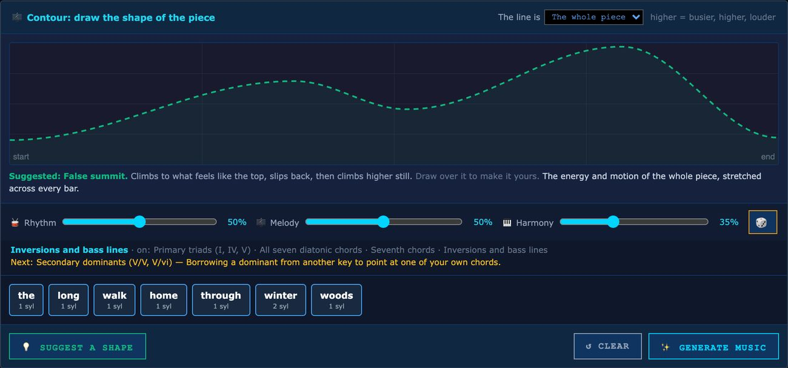

- **Real musical form.** 33 forms in 11 families: sentence and period, binary and rounded binary, bar form, the 12-bar blues, verse-chorus, rondo, sonata, fugal exposition, theme and variations, passacaglia, arch, minuet and trio, call and response, and more.
- **Whole works.** **Expand**, on the score's toolbar, turns a piece into a multi-movement *work*, from 8 plans (sonata cycle, song cycle, baroque suite, concerto, diptych and others), with contrast between movements, a key plan that comes home, and later movements quoting earlier ones. Length is adjustable.
- **Two devices that change the harmony.** *Approach scales* borrow a whole collection that points at the next chord and walk into it, with a choice of collections and how often. *Departures* step out to another key's colour, and you choose how they move and whether they come home.

### A composer that explains itself

- **Outside notes are placed on purpose.** A chromatic note comes from somewhere: a borrowed collection, a leading tone, an approach, a planned excursion. Tests measure how many slip through without a reason.
- **Where the music comes from** gives the home key, the form, each borrowed chord with its source scale and purpose (you can audition each one), every trip out of the key and back, the progression bar by bar, why melody notes leave the scale, and how the texture changes. Type a progression there to browse the approach chords into it.
- **Change one thing at a time.** *Adjust this take* keeps the seed and changes a single decision, so you hear only that decision: piano or four-part texture, the form, and 11 harmonic devices (sevenths, inversions, secondary dominants, borrowed chords, chromatic mediants and others) set to auto, on or off. **New take** rolls a new seed when you want one.

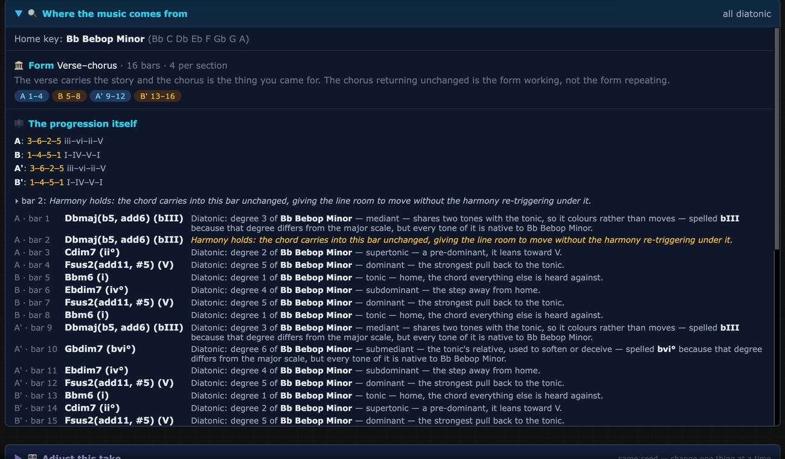

### Hear it and perform it

- **Nine playback voices:** piano (plain, with reverb, pad or strings), strings, guitar, electric piano, and R&B synth and pad.
- **Feel that a performance does:** four swing settings, three levels of expressive timing, and notes pushed or laid back against the grid.
- **18 voicing styles** (close, drops, shells, quartal, gospel, rootless and more) plus 5 automatic strategies, with voice leading between chords. Set them for the whole piece or bar by bar.
- **MIDI export** to any DAW, matching what is on the page.

### A course that teaches inside the studio

- **20 lessons at three levels.** *Beginner* covers notes, scales, chords, inversions, chord symbols, endings and common progressions. *Intermediate* covers voicings and drop 2, bebop major, and the 5-of and 4-of ways into any chord. *Advanced* covers approach chords, chromatic mediants and progressions into a target. Intermediate and Advanced are built from the lecture *Finding Melodies in Scales*.
- **Lessons use the real tools.** A studio lesson lays out only the tools it needs and leaves the rest in a *More tools* drawer. **Show me** points at the control and a button beside it makes the setting for you. Steps that set something tick themselves when the studio reaches that state. Five lessons add a playable part: chord symbols on any root, a guess-the-ending game, progressions that load into the generator, and tables of the ways into a chord.
- **Five guided Learn pages** cover notes on piano, notes on guitar, scales, chords and inversions. Each has its own practice or check and a way on to the next lesson. Progress is saved in your browser.
- **Your instrument, all the way through.** Choose the guitar and the Learn pages show necks in place of keyboards, with its sound and its words, and studio lessons show a dock with only the guitar. The piano, guitar, scales and chords pages listen to the typing keyboard and to MIDI, so you can practise on a real instrument.
- **Tools point back to lessons.** A *Learn* chip on a module header lists the lessons that use it, and the Studio tools cards on the landing page do the same. The OG look and folded rails don't show the chip.

<p>
  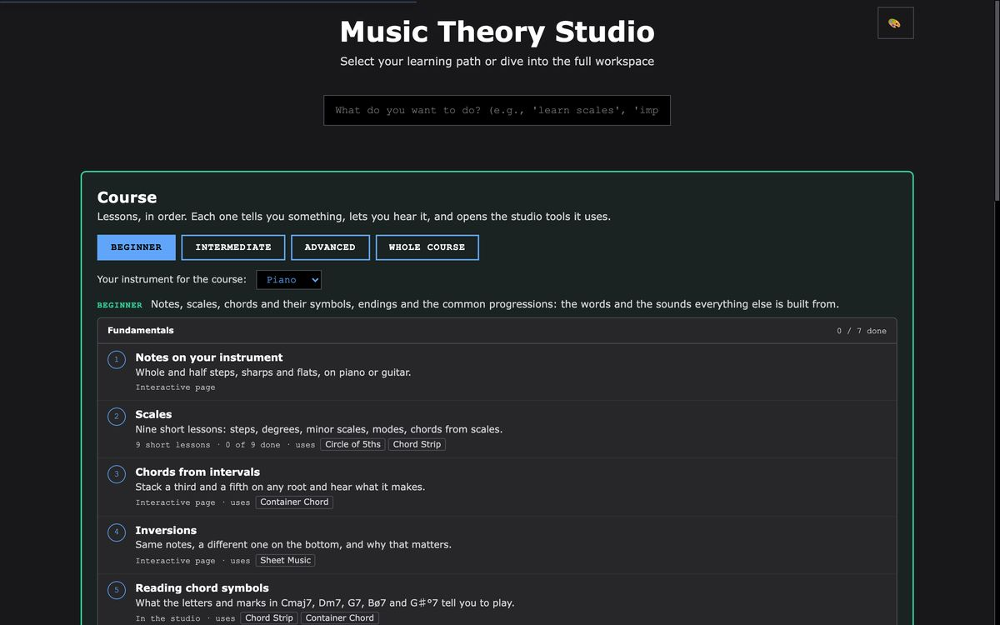
  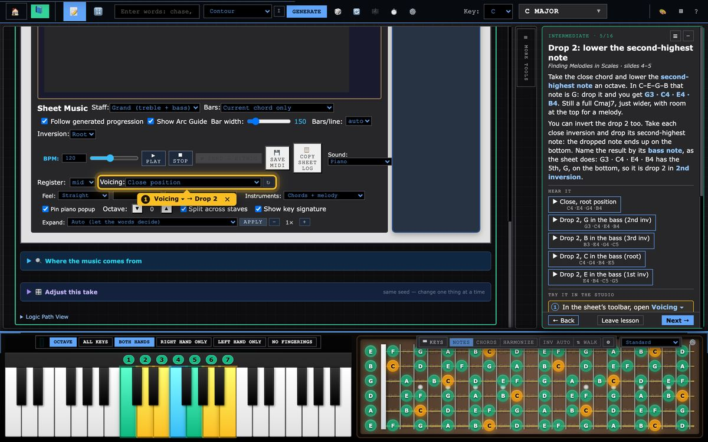
</p>
<p>
  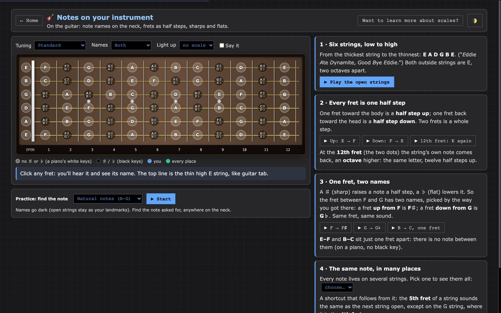
  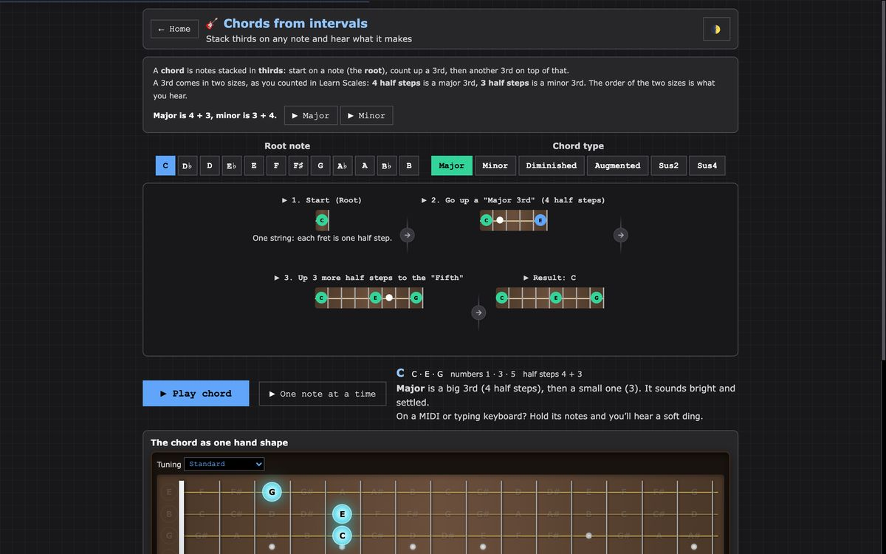
</p>

### A studio you can rearrange, and learn from

- **Five built-in looks** rearrange the same tools around a different principle. *OG* is the original layout, with everything on screen, and is where the studio opens. *Stage & Wings* (at the top of this page) gives the score the whole stage, with every tool a click away at the edges. *Notation Desk* keeps page proportions and puts the reference tools behind a drawer. *Luthier* is for players and puts the fretboard first. *Focus* shows one tool at a time.
- **Build your own look.** Remix any look or start from a skeleton, give each zone a purpose, and name the idea behind it. Looks save in your browser and export as a small `.look.json` file another person can import.
- **Four visual themes:** Clean DAW, Channel Strip, Matrix FX and Steam 2000. The 🎨 button steps through them.

<p>
  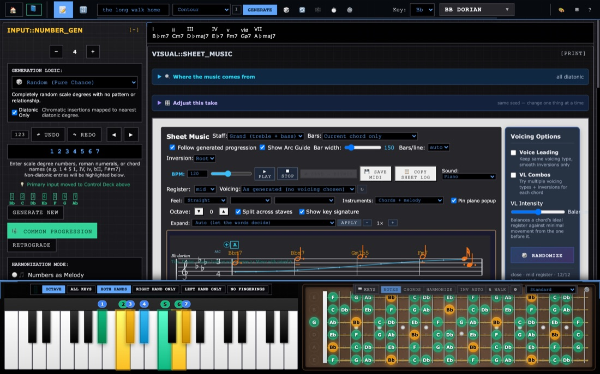
  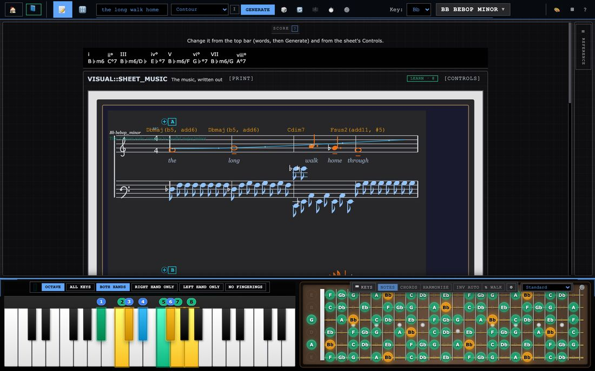
</p>
<p>
  
  
</p>

### Play it

- **Your computer keyboard is an instrument**, laid out like FL Studio's: two rows of piano keys, ← → for octave and ↑ ↓ for velocity. It never takes over while you are typing in a text box.
- **Chords mode** puts the scale's chords under your fingers, with sevenths on the row above and secondary dominants on the black keys. Each chord goes through the same voicing engine as the score. **A** picks the inversion. **F** "walks" the inversions as you play.
- **Harmonize mode** treats what you play as a melody and puts a chord from the scale underneath it. It works with a MIDI keyboard too.
- **One guitar tuning everywhere.** Choose from 12 tunings (Drop D, DADGAD, open tunings and more) or type your own. Necks, chord shapes and lessons all follow it, and it is remembered for your next visit.
- **A piano that shows its work:** scale degrees in colour, and standard fingerings for either hand or both, which you can turn off.

### The tools

| Tool | What it does |
| --- | --- |
| **Sheet Music** | The score: the toolbar for staff, bars, tempo, voicing, feel, sound and Expand, plus **+** marks to add a section to the form |
| **Chord Strip** | One chord for each degree of the scale |
| **Circle of 5ths** | Keys as wedges, with a relative-minor ring. Clicking one changes the studio's key. Switches to 4ths or chromatic order, and numbers the scale's notes (Notes / 1 2 3 / Both) |
| **Solar System** | The scale as orbits around its tonic, with every note a numbered planet on its own ring. Click a planet to zoom in on its moons: the chords that lead to it or hold it, each numbered from the planet and named for its role. Click a moon to add it to the score |
| **Container Chord** | "Which chords contain these notes?" Type or pick the notes, narrow the list to the scale if you like, and add a chord to the score |
| **Scale Relations** | "Which scales contain this chord?" Filters by tonic, then previews a scale on a piano with its chords, or applies it |
| **Generator** | Type a progression as numbers, numerals or chord names, or generate one with a logic of your choice, then rotate it, run it backwards or swap in a common progression. It writes degrees as numbers, and the **123** button switches them to roman numerals |
| **Piano and Fretboard** | The instrument dock along the bottom, showing the scale and the chord being played |

<p>
  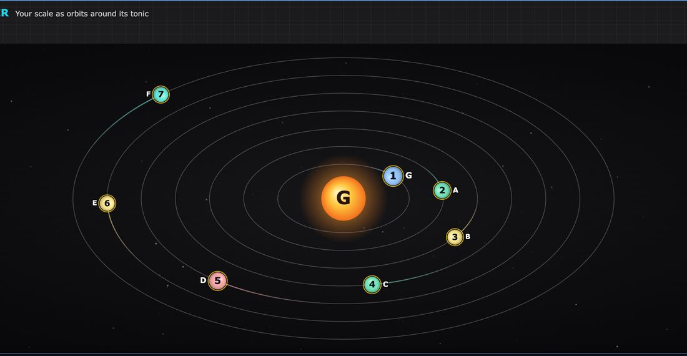
  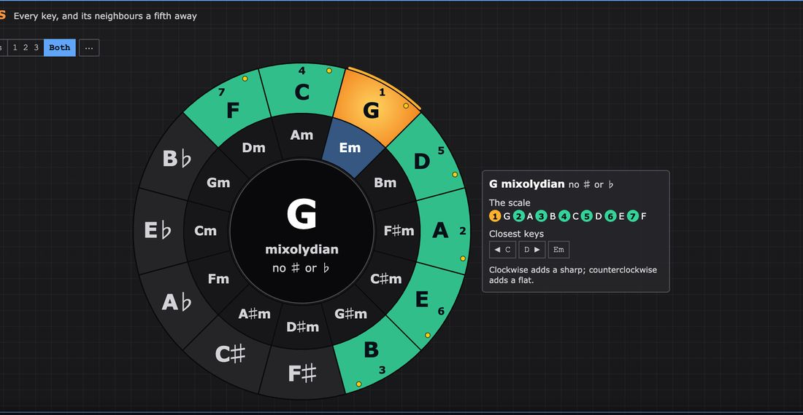
</p>

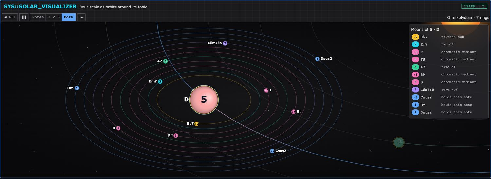

### The scale catalogue

**All 2,048 sets of notes that contain a root**, with over 3,800 further names kept alongside the display names and shown in their own traditions. Dorian also appears as 22 Kharaharapriyā under Carnatic and Kafi thaat under Hindustani. Names that no source confirms are marked as such, and scales from other traditions are marked as approximations in twelve notes.

- **Four ways in:** a Family Tree of 24 families, each organised by its own tradition's system (modes, jazz parents, thaats, melakarta, maqam and more), a Special View, and From Major or From Minor by how many notes differ.
- **Search by any name,** ignoring case, diacritics and ♭/b spelling, and see which name matched. "Kafi", "raga bhim" and "mixolydian b6" all work.
- **Spelled from its own notes.** Seven-note scales get a key signature counted from the scale itself. Other sizes are written without a signature.

<p>
  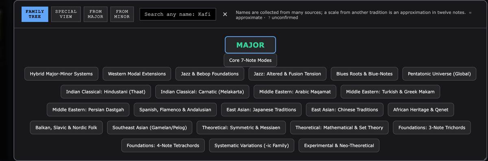
  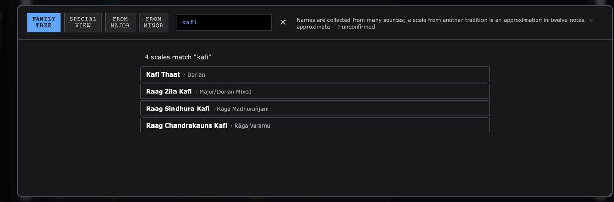
</p>

---

## The idea

Most generative music is individually correct and collectively about nothing. The studio already had the theory machinery. The hard part was **intention**: placement, commitment, repetition and restraint. The generator is tuned against pieces that show those qualities:

- **Minuet in G**: simple chords, full of character, because it moves in gestures that commit to a direction.
- **Für Elise**: chromatic notes exist for motion, and there are very few of them. The E–D♯–E rub works because it keeps coming back.
- **Bach's Prelude in C**: one figure, never varied, while the harmony walks through it.
- **Pachelbel**: a melody on top and a melody on the bottom at the same time.
- **Ellington**: a highlighted moment is built on and escalated, not repeated.

That philosophy runs through the whole app. Each look is a theory of what belongs next to what. The score can account for its chromatic notes. The musical rules are checked by tests in `tools/` that measure them across many seeded pieces.

---

## Where the work stands

*As of November 6, 2026.*

### Finishing: the scale catalogue

The scale picker was the part of the app that most misrepresented what it knew. Names had lost their accidentals, each scale had only one name, 119 scales couldn't be reached, and 562 of the 2,048 sets of notes were missing, including Whole Tone and Chromatic. Family rules, unique ids, restored names, search by any name and the full 2,048 are all in. What remains, planned by November 13, is a final run of every check at both window widths and a rehearsal of the demo path.

### Recently finished

- **Number generator:** degrees are written as numbers first, with roman numerals a click away. The Play Sequence and Harmonize buttons are gone, and the left column in OG holds its width.
- **Solar System and Circle of Fifths:** both redrawn to fit any look, with numbers on the notes and one thin control bar. See [The tools](#the-tools).
- **Five looks instead of thirteen:** the ones that gave every tool room to work.
- **The course:** lessons for all three levels, steps tied to real controls, playable widgets, and one shared frame for all five Learn pages.
- **Guitar tuning:** one setting shared by every neck and Learn page. The instrument chosen for the course holds through its lessons.
- **The grading key is gone:** the piano keeps its degree colours and the chord finder keeps plain fit labels. Looks saved with the key still load, without it.
- **Contour:** drawn by hand with named shape suggestions, with the old word lexicons replaced by a smaller word reader.

### Known rough edges

- **Undo in text boxes:** Ctrl/Cmd+Z in a text box hits an error and does nothing.
- **Printing:** the score's **[PRINT]** button isn't connected to anything yet.
- **Stopping:** a score that is playing can keep going after you leave the studio.
- **Engraving:** the score prints a raw scale id above the staff and a "Tips" line across it, and lyrics can collide.
- **Guitar in the course:** the chord-symbols table in *Reading chord symbols* always draws a keyboard, even when you chose the guitar.
- **Harmonization mode:** the Generator's three choices reach the score, but none of them changes a generated piece yet. The chord picking behind them was removed with the old progression builder.
- **Leftovers:** a greyed-out *Send → Bitwig* button on the score's toolbar, a Generator hint pointing at a "Control Deck" that no longer exists, and some landing-page tool descriptions older than the tools they describe.
- **Long sessions:** the app's interaction log grows without limit.

### Planned next

- **Notation:** tuplets, slurs, and key changes shown in the score when a work modulates between movements.
- **Phones:** a layout and sound that work there, including a test on a real iOS device.
- **Scale direction:** different ascents and descents shown on the keys, for ragas and maqams with a source for the path.
- **Guides:** a feature guide, a guide to what the generator is doing and why, and a generated reference for the form and work catalogues.

### Where it could go

- **Classrooms.** A look is a lesson plan in miniature. A teacher can build one that puts exactly the tools a unit needs in the order it teaches them, then share it as a file.
- **Songwriting and scoring.** Spotting reads a scene description as cue timings. Two Lines and the approach devices produce material worth taking into a DAW through MIDI export.
- **Practice.** Chords mode and Harmonize make any keyboard, MIDI or QWERTY, into a voice-leading and harmony trainer.
- **Research and teaching about text and music.** Seven explicit, inspectable readings of text into music, each one documented in the app with what it reads and what it controls.

---

## Running it yourself

It is plain HTML, CSS and JavaScript with no build step and nothing to install.

```sh
git clone https://github.com/parkerchace/MusicTheory.git
cd MusicTheory
python3 -m http.server 8000
# open http://localhost:8000/modular-music-theory.html
```

Opening `modular-music-theory.html` straight from disk also works. A local server is better for Web MIDI.

**Browsers:** current Chrome, Edge or Firefox, all of which support MIDI keyboards. Safari has no Web MIDI, so it runs the studio without MIDI input. It is designed for a desktop or laptop screen; a phone layout is planned.

### Tests

**Engine tests** run in JavaScriptCore, which ships with macOS, so no Node is required. There are 51 files in `tools/`, and the slowest takes about a minute:

```sh
JSC=/System/Library/Frameworks/JavaScriptCore.framework/Versions/Current/Helpers/jsc
$JSC tools/<name>-test.js                 # one test
for t in tools/*.js; do $JSC "$t" > /dev/null 2>&1 || echo "FAILED $t"; done
```

On November 6, 2026, 44 of the 51 passed. Of the other seven, four are long-standing musical targets not yet met: `accidentals-test` (78 melody notes have no explanation), `melodic-paths-test`, `metric-hierarchy-test` and `modal-excursion-test`. Three are out of date and need updating: `look-schema-test` and `look-wire-test` still ask for looks that were removed, and `scale-switch-reset-test` still expects the Generator to write roman numerals by default.

**Browser checks** drive the real app in muted headless Chrome. There are 87, and a full run takes 40 minutes or more per window width, so split it with `--shard`:

```sh
python3 tools/screens/look-screens.py checks                   # all checks at 1440x900
python3 tools/screens/look-screens.py checks --size 760x900    # a narrow window
python3 tools/screens/look-screens.py checks --only course     # checks with "course" in the name
python3 tools/screens/look-screens.py checks --shard 0/3       # the first of three parts
python3 tools/screens/look-screens.py shots                    # a screenshot of every look
python3 tools/screens/look-screens.py course                   # the landing page and every studio lesson
```

On November 6, 2026, all 87 passed at 1440x900 with no page errors.

### Where things live

| Area | Files |
| --- | --- |
| Page and app wiring | `modular-music-theory.html`, `modular-app.js`, `module-selector.js` (landing page and page switching), `tutorial-system.js`, `theme-switcher.js` |
| Words → context | `context-engine.js`, `word-character-engine.js`, `semantic-contour-engine.js`, `scale-intelligence-engine.js`, `scoring-methods.js` (the seven readings and the devices) |
| Composition | `arc-ui-init.js` (the pipeline), `form-planner.js`, `functional-harmony.js`, `harmony-complexity.js`, `progression-library.js`, `numeric-progression.js`, `approach-engine.js`, `scale-colour.js`, `melodic-line-engine.js`, `piano-texture-engine.js` |
| Contour and adjusting a take | `composition-timeline-ui.js`, `contour-meaning.js`, `composition-controls.js` |
| Score, voicing, playback, MIDI | `sheet-music-generator.js`, `voice-leading-engine.js`, `music-provenance-panel.js`, `logic-path-3d.js`, `simple-audio-engine.js`, `enhanced-audio-engine.js`, `piano-sample-engine.js` |
| Theory data and scale picker | `music-theory-engine.js`, `chord-attribute-engine.js`, `scales-data-embedded.js`, `scales-loader-embedded.js`, `scale-taxonomy.js`, `scale-library.js`, `scale-helper.js`, [`tools/scales/`](tools/scales/README.md) (the catalogue build) |
| Theory tools | `number-generator.js`, `container-chord-tool.js`, `scale-relationship-explorer.js`, `scale-circle-explorer.js`, `solar-system-visualizer.v2.js`, `viz-controls.css` (the bar the circle and the solar system share) |
| Looks | `look-schema.js` (what a look is, and its validator), `studio-looks.js`, `look-builder.js`, `module-fit.js` |
| Instruments and input | `piano-visualizer.js`, `guitar-fretboard-visualizer.js`, `guitar-tuning.js` (the one tuning every neck reads), `instrument-dock.js`, `qwerty-keys.js`, `qwerty-chords.js`, `midi-input-manager.js` |
| Course | `course.js` (the lessons), `course-runner.js` (a lesson inside the studio), `course-theory.js` (spelling and chord naming), `course-widgets.js` (playable tables and games), `course.css` |
| Learn pages | `learn-common.js` (what they share), `learn-piano-notes.js`, `learn-guitar-notes.js`, `learn-scales.js`, `learn-chords.js`, `learn-inversions.js` |

---

## Credits

Created by **Parker Chace**.
